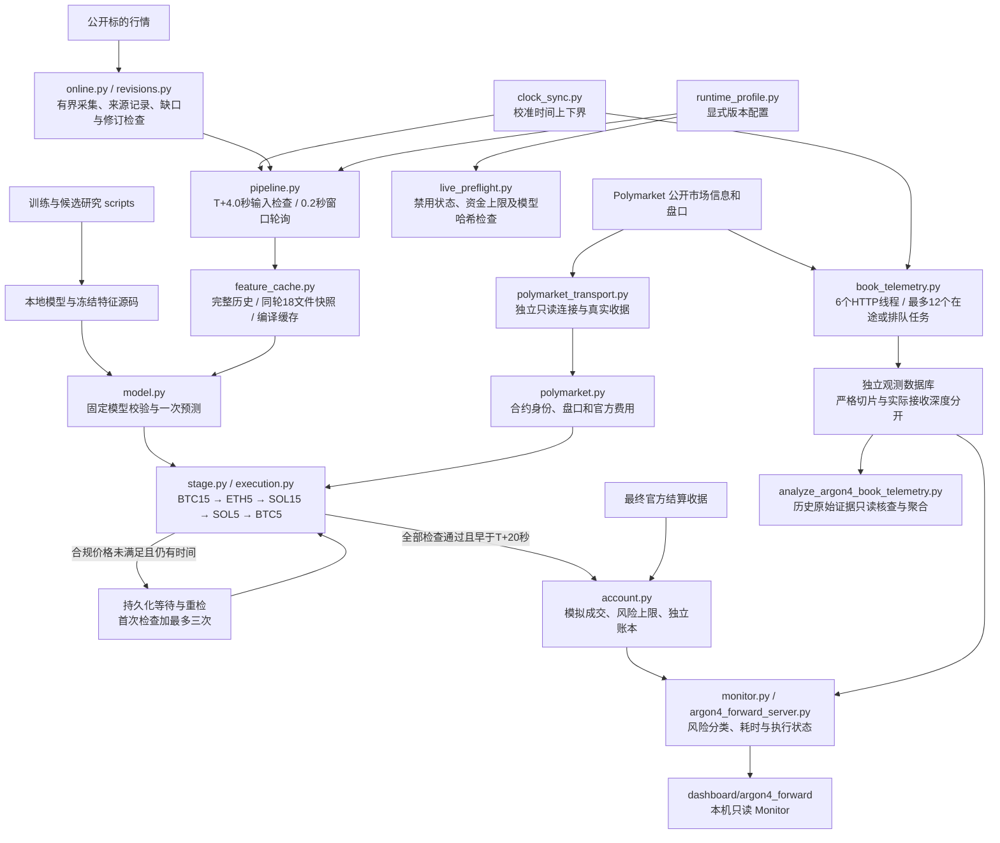

# 系统结构

## 预测与执行路径

当前配置 `argon4-local311-independent65-20261107-v13r2` 从 `2026-11-07T11:40:00Z` 的未来窗口生效，启用 Stage 2 的五条流；流顺序与生效边界以 `config/argon4_forward_policy.json` 为准。模型、特征公式、阈值及权重保持。每个五分钟窗口只计算一次预测；未到周期和无信号立即放行，缺失或不一致证据停止相应分配。

采集最早在校准时间下界达到 T+4.0 秒后开始，校准时间上界达到 T+14 秒即截止。仅当历史完整、唯一问题为最后一根已闭合 5m K 线尚未发布时，允许间隔 0.5 秒再检查；网络错误、历史缺口、修订冲突或辅助输入异常不按发布延迟重试。窗口附近的主循环间隔为 0.2 秒。

v12r1 将完成热身的 `REVISION_WAITING_FUTURE_WINDOW` 纳入同一调度，时钟有效时普通期每 1 秒、关键窗口每 0.2 秒检查。初版该状态仍可能落入 inactive 分支的 10 秒等待，使修订后的新窗口启动过晚。未热身或无效时钟继续保守等待，默认修订仍跳过当前窗口，未来新窗口必须重新验证。v13 仅为已老化的 5m 历史修订增加显式同窗例外：双收据、完整归档、尚无本窗决策及14秒内全输入重验均通过才继续；进程重启不能继承例外。旧收据和决策不重写，资金费和1h mark仍走原流程。

v13r2 对已因输入问题放弃且尚无预测、订单或重检的窗口，增加 T+70 至 T+180 秒之间的有界维护，每窗最多两次。只有第一轮仍为待确认，才允许在其完成时间上界后至少 60 秒开始第二轮；每次使用独立冻结的校准时钟，继续原60秒双收据规则，不走同窗快速许可。暂停、政策变化、旧请求未退出或时间预算失效都会阻止发布；已实际切换后的许可取消只完成未来窗口审计，无法验证真实切换时间时仍保留 PREPARED 阻断。维护不评分、不重设已处理窗口，下一窗口必须重新采集核验。

每次模拟买入都检查新鲜盘口、官方费用和原资金上限。0.515 限制盘口成交价，手续费另计并占用预算。首次盘口价格未满足时，可以持久化等待并最多重检三次，间隔至少 2.5 秒；安排重检须有至少 3 秒余量，最晚 T+18.5 秒启动重检，所有模拟接受检查必须早于 T+20 秒。等待上层重检时，下层暂不占预算；最终有效价格拒绝才放行。中断请求、部分成交及已成交订单不能借重检重复执行。

暂停、禁用、停止、政策或时钟变化会作废挂起重检。每次尝试有独立证据，同一窗口的预测与预算不会重复建立，也不补停机期间的历史订单。上层重检可能压缩下层时间，不能只凭多看几次推断总成交量或收益增加。

## 观测与风险

盘口观测使用独立连接、线程和数据库，不持有模拟执行的连接或资金锁。v12 按校准中心时刻派发；严格 `OBSERVED` 仍要求整个时钟区间证明请求在目标后、响应在目标后一秒内。时钟交叠、迟到和漏采分别标识。完整、有效但不符合严格切片的响应，可在 `actual_observation` 提供真实接收时间及含费深度；它不是目标瞬间盘口，也不是成交。

只读分析脚本从保留的原始盘口、时钟与 Gamma 收据重新核验身份、时间和费用，按原记录的 profile 与目标偏移分组，同时列出实际接收延迟。缺少历史费用证明时，不借用当前费率。脚本不更新数据库、历史样本状态或账本。

Monitor 将未结算仓位分成窗口进行中、已到期等待官方结算、时间暂不确定三类。三类成本与费用均继续占用原风险额度；到期本身不会释放现金或生成盈亏。结算查询在开窗前 30 秒至开窗后 20 秒避让，并在每次请求前复核；未到期仓位不发结算请求。已发出的网络操作无法保证硬实时完成，迟到入场仍被拒绝。

## 部署边界与入口

`execution.py` 只记录本地模拟。实盘准备检查使用同一配置，核对禁用状态、资金上限与模型哈希；**真实订单适配器和签名器尚未实现**。仓库没有配置交易所账户密钥，不能把预检通过当作实盘就绪。

采集保持有界线程池和 0.25 秒最小发出间隔。迟到结果不能成为当轮交易输入；低频预取仅使用已经闭合的观测，资金费保持真实事件。完整说明见 [v13 修订规则](ARGON4_REVISION_V13.md)、[v12 执行与观测规则](ARGON4_EXECUTION_V12.md)和 [v11 采集、快照与修订边界](ARGON4_LATENCY_V11.md)。

运行入口为 `scripts/argon4_forward_server.py`，前端通过本地只读 API 获取状态。训练入口为 `scripts/train_argon4_forward.py`；独立十一流候选入口为 `python -m tools.argon4_research11`，不会修改生产模型和策略；`train/evaluate_argon4_gen4*` 与组合场景脚本仍是独立候选研究。源码克隆不包含模型、行情、账本或完整验证凭据，不能直接恢复原模拟账户。当前修正版验收进度见 [EXPORT_VALIDATION.md](EXPORT_VALIDATION.md)，不同部署时期的历史快照分别见 [EXPORT_VALIDATION_V12_INITIAL.md](EXPORT_VALIDATION_V12_INITIAL.md) 和 [EXPORT_VALIDATION_V11.md](EXPORT_VALIDATION_V11.md)，旧实测不能充作本次修复后的结果。
