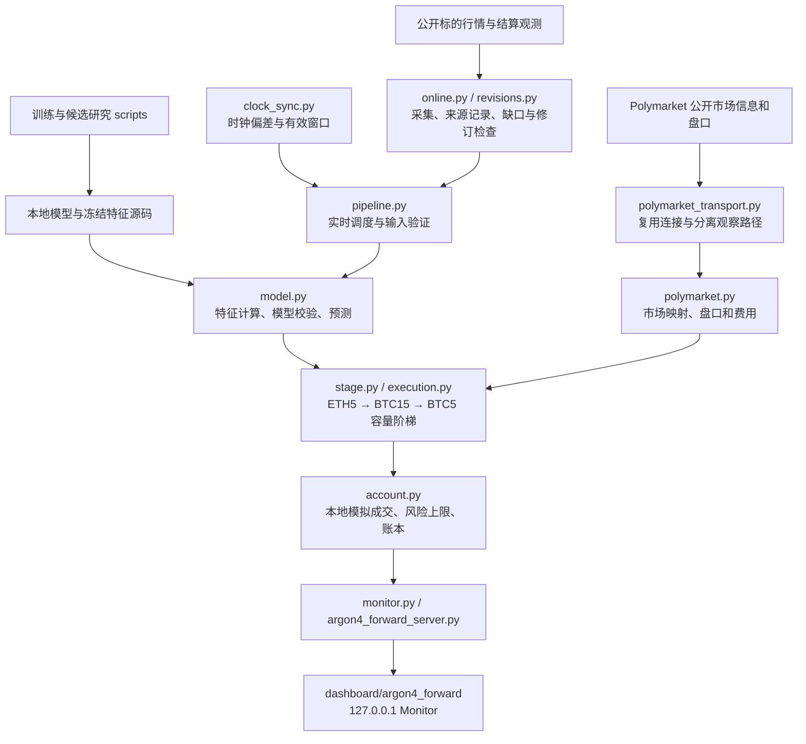

# 系统结构

`execution.py` 只记录本地模拟。限价、风险上限、流启用状态以 `config/argon4_forward_policy.json` 为准。没有信号、尚未到期或经确认的价格不满足可以跳过；缺失、失效或不一致的证据必须停止相应分配，不能猜测容量。已批准但未完成的上层目标与有效跳过是不同状态。

实盘准备文件仅描述禁用状态，不提供钱包签名和真实下单通道。当前仓库也不配置交易所账户密钥。

运行入口：`scripts/argon4_forward_server.py`；前端通过本地只读 API 获取状态、账本和权益。训练入口：`scripts/train_argon4_forward.py`。`train/evaluate_argon4_gen4*` 和组合场景脚本为独立候选研究。
