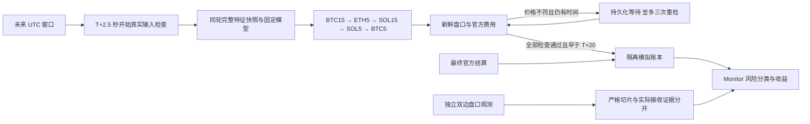

# ARGON4 v12：提前检查、窗口内重检与五流模拟

这是执行与观测规则的新版本，不是模型更新或盈利证明。模型文件、特征公式、阈值与权重不变。盘口成交价仍不超过 0.515；手续费另外计算，并计入单笔、单币及总资金上限。实盘执行器与签名器仍未实现，真实交易保持关闭。

## 未来窗口生效的 Stage 2

用户确认启用 BTC 15m → ETH 5m → SOL 15m → SOL 5m → BTC 5m，按本地已保存研究结果的原始胜率排序。ETH 15m 与 BNB 15m 的模型保留但本阶段不执行。阶段生效时间必须是部署之后的完整五分钟 UTC 边界，不回放停机或检查期间的历史窗口。

SOL 模型清单与模型文件匹配现有政策固定哈希。真实 READY 输入的一次严格核对中，三个币种各保留 6,417 根完整历史，五个到期模型的全部特征、分数、方向和阈值选择与原实现逐位一致。本次没有重训，也没有用旧回测利润为模拟账户入账。

## 提前采集与有限重检

- 最早采集时间从开窗后 5 秒改为校准时间下界达到 2.5 秒；窗口附近轮询间隔为 0.2 秒。旧 v11 配置仍要求至少 5 秒。
- 采集仍在校准时间上界达到 T+14 秒时截止。只有唯一问题为上一根 5m K 线尚未发布、历史完整且仅差最新一根时，才每隔 0.5 秒再次检查。网络错误、历史缺口、价格冲突、资金费异常或辅助输入过期不按发布延迟重试。
- 同一窗口只计算一次预测。只有新鲜、身份与官方费用已核验的盘口确实高于限价，才允许首次加最多三次价格重检；间隔至少 2.5 秒，安排重检须有至少 3 秒余量，最晚 T+18.5 秒启动重检。
- 每次请求前保存 REQUESTED 记录，返回后保存其完整证据与结果。中断请求、错误、已成交、部分成交或零成交订单不能借重检重复执行。
- 授权及模拟成交必须早于 T+20 秒；迟到响应不能成交。暂停、禁用、停止、政策或时钟变化会取消挂起重检。重启不恢复过去的预测与订单。
- 等待上层价格重检时，下层不能提前占用预算；无信号及未到周期仍立即放行。重检可能增加上层机会，也可能压缩下层时间，不能预先保证总成交量增加。

官方结算查询从入场关键路径移开：开窗前 30 秒至开窗后 20 秒不启动查询，每个市场请求前重新检查；尚未到期的仓位不发无效结算请求。正在进行的网络与磁盘操作仍受实际调度影响，20 秒入场检查始终保留，并不承诺固定完成秒数。

## 盘口切片与真实接收深度

v12 用校准中心时刻派发独立的只读观测；六个 HTTP 工作线程、最多十二个进行中或排队任务，支持五流到期时十个双边样本。发送前仍检查时钟、截止与队列状态，不能靠扩大队列无限追赶。

严格 OBSERVED 的一秒口径不变：完整时钟区间必须证明请求在目标之后、响应在目标后一秒之内。中心派发可能与目标时刻的时钟区间交叠，此类记为 AMBIGUOUS_SAMPLE，不伪装为精确准时观测。

完整、有效但迟到或时间交叠的盘口，另在 `actual_observation` 保存真实请求与接收时间上下界、买卖一和含费容量；未知费用仍为空。该深度的含义是 **实际接收观测，不是目标瞬间盘口，也不是模拟成交**。严格切片和实际接收统计分开，旧顶层迟到 capacity 仍为空，防止旧统计误用。

重启前已排入的观测保留 PROCESS_RESTART 状态，不用新版重新填充同一历史样本。部署前后比较必须排除这些重启样本，并使用真实时间区间。

`scripts/analyze_argon4_book_telemetry.py` 以只读方式检查保留的盘口、时钟和 Gamma 原始收据；通过 SHA256 关联历史身份及费用证据，不使用当前费率替代历史证明。对旧 140 个目标的核查中，22 个原严格切片状态不变；136 个响应可验证实际接收深度，其中 114 个来自非严格切片。3 个盘口超过原两秒新鲜度上限，1 个缺少收据，报告保持部分证据不足状态。按目标偏移分组仅是统计标签，不能称为重建精确时刻盘口。

## 活跃与待结算风险

Monitor 将同一未结算成本分成窗口进行中、已到期等待官方结算、时间暂不确定三类，并按币种汇总。只有校准时间下界已达到 window_end 才确定到期；时钟失效或边界交叠归为不确定。

三类成本与手续费全部继续占用原风险额度，不能重复使用尚未返还的现金。没有把窗口结束或参考币价当成官方结算。改造前实际记录未发现旧窗口占满单币风险上限而拒单，因此本版没有放宽风险限制。

[官方结算说明](https://docs.polymarket.com/concepts/resolution)与[订单生命周期](https://docs.polymarket.com/concepts/order-lifecycle)也需区分：市场到期不是本地已收到最终结算；部分市场有额外 taker 延迟。当前模拟按真实可用盘口和费用约束，不能声称完整复现真实队列、延迟与撮合。

## 结构与验收

测试覆盖旧版本兼容、五流优先级、固定分数复用、价格重检持久化、取消与截止、时钟区间分类、真实接收容量和风险金额对账。公开验证摘要记录实际测试结果与部署观测；原始收据、模型、行情、账本和账户信息仅保留本机。
