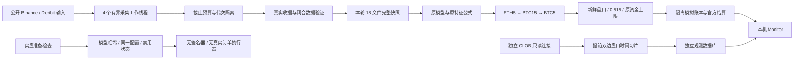

# ARGON4 v11：实时采集与观测

这一版只改变工程路径。部署模型与阈值、ETH 5m → BTC 15m → BTC 5m 的顺序、0.515 限价、全部资金上限、开窗后最早 5 秒决策与 20 秒到期均保持。模拟成交继续使用新鲜盘口、官方费用和原有 IOC 规则；无历史补单。

## 截止预算与并发

`OnlineInputs.refresh()` 接收本轮 `deadline_monotonic` 与 `cohort_id`。流水线将采集截止设为开窗后 14 秒的校准时间上界，保留计算及执行余量。单次请求分别采用不超过剩余预算的 2 秒连接、3.5 秒读取超时；0.25 秒最小发出间隔保留。

网络等待不再占用整个全局请求锁。每个工作线程持有自己的连接；队列、并发数、退避和任务代次均有界。到期立即返回阻断，不等待迟到任务完成；迟到任务不能发布工作输入、缓存检查或覆盖后续代次。若旧任务尚未退出，下轮会明确报告忙碌，而非不断增加线程。读取超时本身不是绝对总时限，仍需要整轮预算与发布隔离。

到期返回路径不进行磁盘写入，也不等待工作线程的发布锁。序列化和文件检查均放在有界工作线程中；发布前再次检查代次。已进入操作系统的原子重命名无法撤回：若该极短系统调用异常卡住，当前轮仍返回阻断，后续轮保持忙碌直到线程退出，并重新完整验证输入；不会把迟到结果标记为本轮可交易输入。

## 低频预取

下一边界前 10 秒内最多预取一次，单轮预算不超过 3 秒并预留边界前 2 秒。仅获取当时已闭合的辅助输入。整点刚闭合的数据仍需边界后采集验证。

Funding 保留真实事件时间与全量事件；短期复用依据已验证收据的新鲜度与观察到的事件间距，不假设固定八小时网格，不补造资金费事件或现金流。

## 严格一致的计算缓存

冻结 `model.py` 与原作者特征源码。新适配器只缓存按源码 SHA256 标识的编译结果；每次调用创建新模块命名空间。一次决策捕获 18 个完整文件字节快照，检查来源哈希、接收截止、OHLC 与时序；ETH/BTC 共用已校验读取结果并取得独立副本。本轮结束释放，不跨轮复用输入。历史不截断。

`scripts/verify_argon4_feature_cache.py` 对比基准与优化路径的全部 311+65 维特征及三个已固定模型的分数、方向、选择。历史快照缺失或已经修订的窗口不算通过；当前文件不能冒充旧决策时的输入。

## 盘口观测

只为未来窗口安排 T+2、6、10、15、20、30、60 秒的 UP/DOWN 观测；只覆盖启用且当期应运行的流。独立连接、最多 6 个请求工作线程、独立 `book_telemetry.sqlite3`，不修改交易或资金记录。

每条保留目标时间、实际请求/接收时间、校准上下界、原始响应与哈希、来源时间、买卖一及 0.515 内深度。含费容量要求可验证的官方费用信息；未知费用为 null。迟到或漏采明确标识，不能拿迟到报价替代目标时刻。模型完成后仅关联其实际决策时间。

这些数据用于观察延迟与报价关系；并不证明提前到达一定成交，也不能据此承诺收益提升。

## 模拟与实盘准备

模拟流水线和 `argon4_live_preflight.py` 使用同一工程配置契约。预检核对禁用状态、资金上限和模型文件哈希，不反序列化外部模型、加载密钥或发送订单。当前工作区禁止实盘；`live_enabled`、签名器和真实订单通道继续关闭，真实执行器尚未实现。

Monitor 显示实际完成时间、采集/计算耗时和观测切片状态。启动脚本先读取健康状态；服务器先占用本地监听端口再创建账户，避免重复启动写入同一账本。

## 中断修订的安全恢复

旧版本可能在归档较大的观察数据库后超过时钟凭证的有效期，导致已替换的数据视图停在 PREPARED 状态并持续阻断。修订提交现在支持在归档后重新校准时间。专用恢复工具默认只读检查，必须核对归档旧数据、已确认收据、候选新数据、当前工作视图和注册表完全一致；只允许补全已完整切换的提交证据，拒绝不明确的部分替换。

恢复采用检查完成后的新生效时间，跳过生效所在窗口。它不改历史订单、模型或资金，也不删除 PREPARED 标记来绕过核验。

## 验收与部署记录

本机证据目录为 `reports/argon4_latency_v11_20261107/`；其中包含改造前代码/模型哈希、账户只读备份、测试日志、严格一致性结果与部署后观测。原始行情、模型、收据、账户及用户配置不上传 GitHub。公开仓库的验证摘要列出真实通过数和遗留失败项，不将工程检查作为策略有效性证明。
